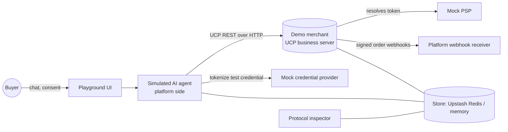

# Architecture

## 1. Principles

1. **UCP is the contract.** Platform and business talk only through UCP HTTP endpoints, even though they share a deployment.
2. **Protocol ≠ UI.** `src/ucp/*` has no React, Next, or storage imports; it is pure TypeScript.
3. **Server-side by default.** Server Components and Route Handlers do protocol work; client components render and collect input.
4. **No hidden shortcuts.** The agent never calls merchant domain services; it can only reach them via the platform's UCP client.
5. **Serverless-safe.** All state lives behind the `Store` interface; no globals hold domain state.
6. **Mark the fakes.** Simulated participants live in `src/sim/*` and are labelled in every UI surface that shows them.

## 2. Context



## 3. Layers and allowed dependencies

```
presentation  (app/**, components/**)         → application, ucp (types only)
application   (src/app-services/**)           → ucp, merchant, platform, sim, persistence interfaces
platform      (src/platform/**)               → ucp, persistence interfaces      (agent, UCP client, webhook receiver)
merchant      (src/merchant/**)               → ucp, persistence interfaces, sim (PSP port)
sim           (src/sim/**)                    → ucp (types)                      (mock tokenizer, mock PSP)
ucp           (src/ucp/**)                    → zod, @ucp-js/sdk only            (protocol adapter, negotiation, crypto, validation)
persistence   (src/persistence/**)            → implements Store; no domain logic
observability (src/observability/**)          → redaction, structured logging, inspector recorder
```

Rule enforced by an ESLint `no-restricted-imports` config and a dependency test (`unit:layering`).
`platform` MUST NOT import `merchant` (and vice versa) — the HTTP boundary is the only link.

## 4. UCP protocol adapter

```ts
interface UcpProtocolAdapter {
  parseProfile(raw: unknown, role: 'business' | 'platform'): Result<Profile>;
  negotiate(business: Profile, platform: Profile): NegotiationResult;     // version + intersection
  validate(op: UcpOperation, direction: 'request' | 'response', payload: unknown): ValidationResult;
  composeSchema(op: UcpOperation, activeCapabilities: ActiveCapability[]): ZodTypeAny;
}
```

* `SdkAdapter` (default): validators come from the official generated Zod schemas (vendored from `js-sdk` 0.6.0 at a pinned commit because npm 0.5.1 cannot validate the pinned profile shape; see `src/vendor/ucp-sdk/PROVENANCE.md`), including extension-composed
  variants (`CheckoutWithDiscountResponseSchema`, …).
* `NativeAdapter`: hand-written, spec-derived Zod for the same operations. Both implement the same contract-test suite
  so divergence between SDK and a native reading of the spec is detected by tests (`unit:adapter-parity`).
* Negotiation, authority binding, header parsing, RFC 9421 signing live in `src/ucp/` natively; the SDK has none of this.

## 5. Component view

| Component | Path | Responsibility |
|---|---|---|
| Profile builder | `src/merchant/profile.ts` | Composes the business profile from enabled capabilities + env |
| Negotiation middleware | `src/merchant/negotiation.ts` | Reads `UCP-Agent`, fetches platform profile (safe-fetch), version check, intersection, attaches `ucp` envelope |
| Checkout service | `src/merchant/checkout/*` | State machine, pricing, discount, fulfillment, messages |
| Order service | `src/merchant/orders/*` | Order build, events, adjustments, status derivation |
| Webhook sender | `src/merchant/webhooks/*` | Outbox rows, RFC 9421 signing, retry policy |
| Catalog service | `src/merchant/catalog/*` | Deterministic INR catalog, search, lookup |
| Mock tokenizer / PSP | `src/sim/*` | Test credentials → tokens → deterministic outcomes |
| UCP client | `src/platform/ucp-client.ts` | Builds headers (`UCP-Agent`, `Request-Id`, `Idempotency-Key`, `X-API-Key`), fetch with timeout/retry, validates, records to inspector |
| Agent | `src/platform/agent/*` | Intent parser, planner, step executor, timeline |
| Webhook receiver | `src/platform/webhook-handler.ts` | Verify signature → authz → dedupe → persist → ack |
| Inspector recorder | `src/observability/recorder.ts` | Redact + persist interaction records, both sides |
| Validator service | `src/app-services/validator.ts` | Module H |
| Scenario runner | `src/app-services/scenarios/*` | Scripted, resettable sequences |

## 6. Demo sessions and tenancy

Each visitor gets an HttpOnly cookie `demo_sid` (random 128-bit). All keys are namespaced `s:{sid}:…` with a 24 h TTL.
The platform's merchant credential is a server-derived API key bound to that session
(`HMAC(SERVER_SECRET, sid)` → `X-API-Key`), so the merchant scopes checkouts/orders to the originating platform exactly
as the Order spec's "platform credentials" authorization describes. Catalog and discovery are open (no credential).
`POST /api/playground/session/reset` deletes `s:{sid}:*`.

## 7. Network topology on Vercel

* Platform code (Route Handlers / Server Actions) calls the merchant at `${PUBLIC_BASE_URL}/api/ucp/v1/*` over HTTPS.
* Preview deployments with Deployment Protection need the `x-vercel-protection-bypass` header; the UCP client adds it
  when `VERCEL_AUTOMATION_BYPASS_SECRET` is set (server-only).
* Webhook delivery to `${PUBLIC_BASE_URL}/api/platform/webhooks/orders` is initiated via Next `after()` so the response
  to the admin action is not delayed; retries are driven by a cron route plus a manual "retry now" action.
  (Vercel Hobby cron is once per day — documented as a limitation; retries on subsequent activity cover the demo.)
* Function config: `maxDuration` 30 s for UCP/PSP routes, Node.js runtime (crypto for Ed25519/ES256 and RFC 9421).

## 8. Directory layout

Next's `src/` layout is used: `app/` below lives at `src/app/`, `components/` at `src/components/`.

```
app/
  (marketing-free dashboard shell)  layout.tsx, (dashboard)/{overview,architecture,discovery,agent,catalog,checkout,payments,orders,webhooks,inspector,validator,docs,scenarios}/
  .well-known/ucp/route.ts
  api/ucp/v1/...            # business endpoints
  api/platform/...          # platform profile + webhook receiver
  api/mock-psp/...          # simulated tokenizer
  api/playground/...        # BFF for the UI (agent, session, inspector, validator, admin, scenarios)
  testing/simulate-shipping/[orderId]/route.ts   # gated
src/{ucp,merchant,platform,sim,persistence,observability,app-services}/
components/{ui,diagram,json-viewer,timeline,...}/
docs/  tests/{unit,integration,e2e}/  scripts/
```
