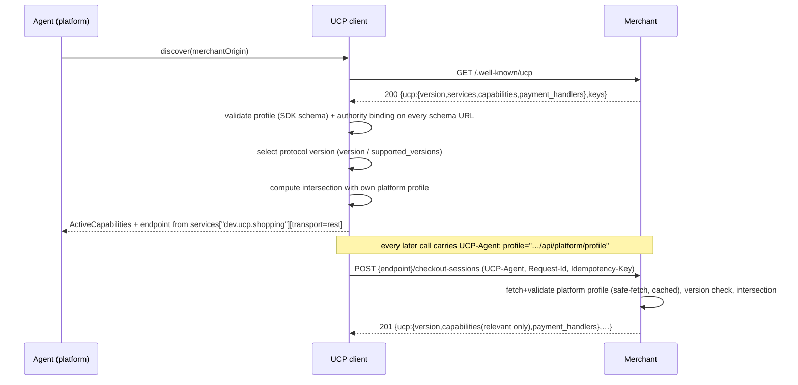
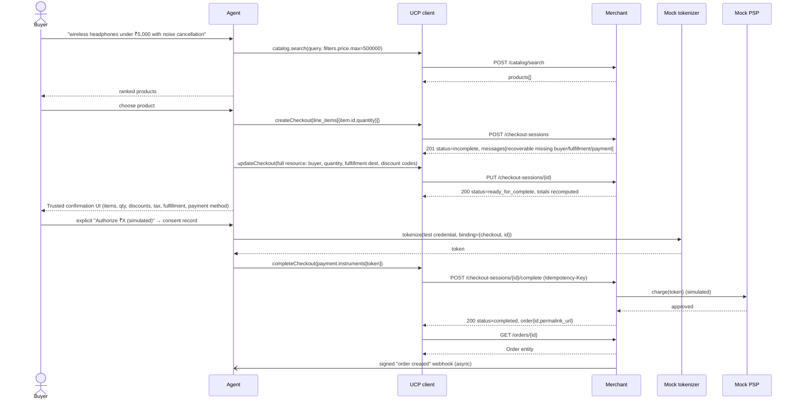

# Software Design Document

Companion docs: `ARCHITECTURE.md` (layers), `API_DESIGN.md` (contracts), `SECURITY_DESIGN.md`, `UCP_SPECIFICATION_MAPPING.md`.

## 1. System context

See `ARCHITECTURE.md` §2. Actors: Buyer (human), Platform (simulated agent + UCP client + webhook receiver),
Business (demo merchant), Mock credential provider, Mock PSP, Merchant admin (human, outside UCP).

## 2. Component architecture

See `ARCHITECTURE.md` §3–§5. The two substitutable seams are `UcpProtocolAdapter` (SDK vs native validators) and
`Store` (memory vs Redis).

## 3. Sequence diagrams

### 3.1 Discovery and negotiation (Scenario 1, 6)



### 3.2 Successful purchase (Scenario 2)



### 3.3 Payment failure and retry (Scenario 4)

`complete` with decline token → merchant returns `200 status=incomplete`, message
`{type:error, code:"payment_failed", severity:"recoverable", path:"$.payment.instruments[0]"}`; checkout returns to
`ready_for_complete` semantics after the platform submits a new instrument. A **new** Complete uses a **fresh**
`Idempotency-Key` (spec: genuinely new Complete operation); retrying the *identical lost-response* request reuses the key
(also demonstrated, to show idempotent replay).

### 3.4 Order webhook (Scenario 5)

```mermaid
sequenceDiagram
  actor Adm as Merchant admin
  participant O as Order service
  participant W as Webhook sender
  participant R as Platform receiver
  Adm->>O: mark shipped (admin console, NOT a UCP call)
  O->>O: append fulfillment event; build full order entity
  O->>W: enqueue delivery (Webhook-Id=evt_…, one outbox row)
  W->>R: POST webhook_url (Webhook-Id, Webhook-Timestamp, UCP-Agent, Content-Digest, Signature-Input, Signature)
  R->>R: verify digest+signature using keys[] from business profile; check order belongs to signer; dedupe Webhook-Id
  R-->>W: 200 (ack first)
  R->>R: persist order snapshot + processing outcome (async via after())
  W->>W: on non-2xx/timeout: retry w/ backoff, max 6 attempts
```

## 4. API contracts

See `API_DESIGN.md`.

## 5. Data models

Protocol entities use SDK types (`Checkout`, `Order`, `Profile…`) — never re-declared. Internal records:

```ts
type DemoSessionId = string;
interface CheckoutRecord { sid; platformId; checkout: Checkout; version: number; createdAt; expiresAt;
                           platformProfileUrl; negotiated: NegotiationResult; consentRef?: string }
interface OrderRecord    { sid; order: Order; checkoutId; platformProfileUrl; events: FulfillmentEvent[]; adjustments: Adjustment[] }
interface OutboxRow      { id: string /*Webhook-Id*/; sid; orderId; payload: string /*exact bytes signed*/; attempts; nextAt; status: 'pending'|'delivered'|'dead' }
interface WebhookReceipt { webhookId; receivedAt; verified: boolean; reason?: string; duplicate: boolean; outcome: 'applied'|'ignored'|'rejected' }
interface IdempotencyRecord { key; requestHash; responseStatus; responseBody; createdAt }
interface InteractionRecord { id; sid; correlationId; ts; actor: 'platform'|'business'|'psp'|'cp'; method; url; reqHeaders; reqBody;
                              status; resHeaders; resBody; durationMs; validation: ValidationResult[]; op: UcpOperation; error?: ErrorInfo }
interface ConsentRecord  { id; checkoutId; totalAmount; currency; lineItemsHash; paymentHandlerId; grantedAt; uiVersion }
```

Key schema (Redis): `s:{sid}:co:{id}`, `s:{sid}:ord:{id}`, `s:{sid}:idem:{key}`, `s:{sid}:ox` (sorted set by `nextAt`),
`s:{sid}:wh:{webhookId}` (SET NX for dedupe), `s:{sid}:log` (list, capped at 2 000), `s:{sid}:agent:{runId}`. All TTL 24 h.

## 6. Protocol integration

* Profile validation: `UcpDiscoveryProfileSchema`. Response envelopes: `UcpCheckoutResponseSchema` /
  `UcpResponseSchema`. Requests: `Checkout{Create,Update,Complete}RequestSchema` plus extension-composed variants chosen
  from the negotiated active capabilities (`composeSchema`).
* The merchant validates **inbound** requests and its **own outbound** responses (output validation is a test-mode hard
  failure and a logged soft failure in production so a bad response is visible, not swallowed).
* Pricing authority: request schema marks `item.price` as `omit` on create/update; merchant ignores/strips client prices.

## 7. State management

**Checkout state machine** (from `checkout/index.md`): states `incomplete`, `requires_escalation`, `ready_for_complete`,
`complete_in_progress`, `completed`, `canceled`.

| From | Trigger (merchant-side) | To |
|---|---|---|
| (new) | Create | `incomplete` or `ready_for_complete` (if create already carried everything) |
| `incomplete` | Update satisfies all required info | `ready_for_complete` |
| `ready_for_complete` | Update invalidates info | `incomplete` |
| `incomplete` ⇄ `requires_escalation` | message with `requires_buyer_input/review` | per messages |
| `ready_for_complete` | Complete accepted, async mode | `complete_in_progress` |
| `ready_for_complete` | Complete accepted, sync | `completed` (+`order`) |
| `ready_for_complete` | Complete rejected (e.g. `payment_failed`) | `incomplete` (+recoverable message) |
| `complete_in_progress` | Merchant finishes | `completed` or back to `incomplete` |
| any except `completed`/`canceled` | Cancel / expiry | `canceled` |
| `complete_in_progress` | Update / Complete | **unchanged**, recoverable error message |

Illegal operation on terminal states returns a UCP error body (`not_found`/not-allowed codes per spec examples); the table
is data, tested exhaustively (`unit:checkout-transitions`). Optimistic concurrency via `version` on the record
(Redis `WATCH`/Lua) prevents lost updates between concurrent Update/Complete.

**Order line status** derived: `removed | fulfilled | partial | processing` (spec formula).
**Webhook outbox status:** `pending → delivered | (retry) → dead`.
**Agent run:** `idle → discovering → searching → proposing → checkout → awaiting_consent → paying → ordered | failed`.

## 8. Error handling

| Class | Where | Shape |
|---|---|---|
| Transport/negotiation | merchant middleware | HTTP 400/422/424 + `{ucp:{version,status:"error"},messages[],continue_url?}` |
| Business outcome | merchant services | HTTP 200 + checkout with `messages[]` (severity per spec) or `ucp.status:"error"` when no resource |
| Auth | middleware | 401/403 as in spec table |
| Idempotency | middleware | 409 on payload mismatch |
| Rate limit | middleware | 429 + `Retry-After` |
| Internal | all | 500 `{ucp:{status:"error"}, messages:[{code:"internal_error",severity:"unrecoverable"}]}`; correlation ID logged, never stack traces in the body |
| Client side | UCP client | typed `UcpError` (kind: network/timeout/protocol/validation) surfaced into the agent timeline |

Retries (client): GET and idempotent POST (same `Idempotency-Key`) on network error/5xx/429, ≤2 retries, jittered backoff,
honoring `Retry-After`; never retry 4xx other than 429. Timeouts: 8 s per UCP call, 5 s per webhook delivery.

## 9. Persistence strategy

`Store` interface: `get/set/delete`, `setNX` (idempotency + dedupe), `incr`, list push/range (capped), sorted-set
add/range/remove (outbox), `withLock(key, fn)`/CAS, TTL on all keys.
Adapters: `MemoryStore` (local dev, unit tests; **refuses to start when `VERCEL_ENV=production|preview`** unless
`ALLOW_MEMORY_STORE=true`), `RedisStore` (Upstash REST client, serverless-safe), optional `PostgresStore` later.
Deterministic mode (`DEMO_MODE=deterministic`): seeded catalog, sequential IDs per session (`chk_0001`), injectable clock,
fixed key pair — used by Playwright and docs examples. Live mode: random UUIDs, wall clock.

## 10. Security architecture

See `SECURITY_DESIGN.md`.

## 11. Deployment architecture

Single Next.js 16 app on Vercel, Node.js runtime Route Handlers, Upstash Redis (Marketplace integration) provides
`KV_REST_API_URL`/`KV_REST_API_TOKEN`-style variables (exact names documented from the integration at deploy time).
Environments: Development (memory or local Redis), Preview (Redis preview DB, protection bypass for loopback calls),
Production (custom domain recommended for authority binding). See `VERCEL_DEPLOYMENT.md` (written in Step 13).

## 12. Testing strategy

| Level | Tooling | Scope |
|---|---|---|
| Unit | Vitest | Profile builder, negotiation vectors (spec table), authority binding vectors, `UCP-Agent` parser, pricing, state machine, payment sim, order status, RFC 9421 sign/verify (spec examples), redaction, layering rule |
| Integration | Vitest + real `next start` on a random port, memory store; Redis tests against a local Redis container in CI | Discovery, checkout create/update/complete, idempotency, payment fail/retry, order create/get, webhook delivery + duplicate + tampered + wrong-business |
| Contract | Vitest | `SdkAdapter` vs `NativeAdapter` parity; every fixture in docs validates against the SDK schemas |
| E2E | Playwright | 7 flows from the brief; screenshot of consent UI; inspector shows the requests the flow made |
| Conformance | official `conformance` suite via `uv`, scripted | Report in `docs/CONFORMANCE_REPORT.md` with pass/fail/skip/unsupported; never inferred from UI tests |
| Schema | Vitest | Official schemas resolved with `ucp-schema` into fixtures, compared with SDK Zod acceptance on the same samples (if the CLI proves practical; otherwise limited to SDK Zod and documented) |
